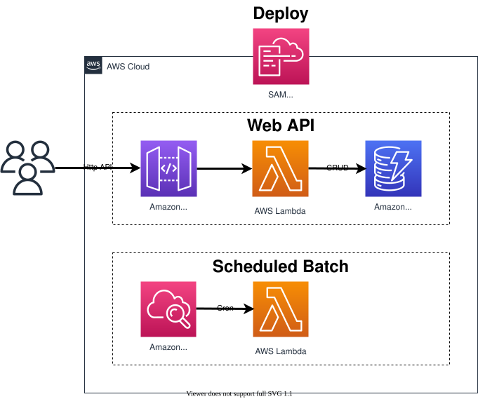

# Template project for AWS Lambda

English | [日本語](README.ja.md)

## 🍀 Basics

* Provides a template of a serverless project structure using AWS Lambda and API Gateway
* Uses the cost-efficient arm64 as the basis of the implementation
* The application as a whole is built with .NET Core, while auxiliary Lambdas use Node.js
* Settings that depend on the environment, such as staging and production, are specified with environment variables
* The boilerplate of the Lambdas is generated automatically with Source Generators
* CloudFormation is used to deploy the application

## ✨ Features

* DI and binding with generated code
* Validation with generated code
* Health check (for warm-up) as a pre-processing filter with generated code
* Formatted log output to CloudWatch Logs with a custom LoggerProvider
* DynamoDB CRUD (the list is paged with a Query on the Kind + CreatedAt GSI, without Scan. Updates use conditional writes on the `Version` attribute for optimistic concurrency, and a mismatch returns 412)
* External Web API calls configured with the IServiceCollection ecosystem
* Conversion between presentation models and core models with AutoMapper
* Unit test sample with the DynamoDB part mocked with Moq
* Scheduled batch processing with CloudWatch Events



## 🔧 Tools

Install the tools for creating the deployment artifacts and for debugging with the following commands.

```
dotnet tool update -g amazon.lambda.tools
dotnet tool update -g amazon.lambda.testtool-10.0
```

## 🚀 Build

Create the zip for deployment with the following commands.
serverless.template is also included in the artifacts as the CloudFormation template.

```
dotnet lambda package Template.Lambda.zip -pl Template.Lambda -c Release -farch arm64
copy /y Template.Lambda\serverless.template Publish\
```

## 📦 Deploy

To deploy from the command line, run the following command in the directory that contains the artifacts.

```
dotnet lambda deploy-serverless --package Template.Lambda.zip
```

## 🔷 Architecture

This section describes the layers of this template.

### 1️⃣ Base

#### ServiceResolver

Defines the DI container that provides the components used by the Lambda functions.

#### ApiFilter/EventFilter

Defines the filters for the Lambda functions of the API and the CloudWatch events.

#### ApiMappingProfile

Defines the mappings with AutoMapper.

### 2️⃣ Functions

Defines the Lambda functions.  
Because Source Generators generate the boilerplate of the Lambda functions, change the definitions in serverless.template as follows.

* Before

```yaml
"CrudGet": {
  "Type": "AWS::Serverless::Function",
  "Properties": {
    "Handler": "Template.Lambda::Template.Lambda.Functions.CrudFunction::Get",
...
```

* After

```yaml
"CrudGet": {
  "Type": "AWS::Serverless::Function",
  "Properties": {
    "Handler": "Template.Lambda::Template.Lambda.Functions.CrudFunction_Get::Handle",
...
```

### 3️⃣ Parameters

Defines the Request/Response structures used by the Lambda functions of the HTTP API.  
Specifying DataAnnotations attributes validates the input obtained with [FromBody].

### 4️⃣ Services

Defines the application service layer.

### 5️⃣ Models

Defines the data structures of DynamoDB and so on.  
Returning the data of the Models layer directly as the Response of a Lambda function is fine, but using it directly as a Request is prohibited.  
For a Request, create a presentation model limited to the necessary items with validation attributes, and map it to and from the data structures of Models.  
Do the same for a Response when the returned items need to be limited.

### 6️⃣ Components

Defines components such as providers and serializers for logging, data access, and so on.

## 🚧 Next steps

* Processing triggered by SNS/SQS events
* RDB operations with RDS Proxy
* Authentication with Cognito
* Stream analysis with Kinesis
