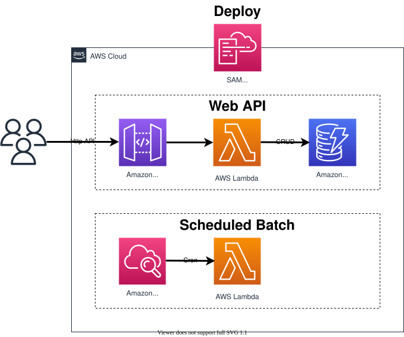

# 設計

## 🍀 基本

* AWS Lambda及びAPI Gatewayを使用したサーバレスプロジェクト構成の雛形を提供する
* コスト効率の良いarm64での実装を基本とする
* アプリケーション全体は.NETで構成する
* ステージング環境、プロダクション環境等の環境に応じた設定が必要な場合は環境変数で指定する形とする
* Lambdaのボイラーテンプレート部分はSource Generators(Amazon.Lambda.Annotations)を使用して自動生成する
* アプリケーションのデプロイにはCloudFormationを使用する

## ✨ 実装機能

* 自動生成した処理によるDI及びバインディング
* 自動生成した処理による入力の読み取りの検査(JSONとして読めない本文は400)
* カスタムLoggerProviderによるCloudWatch Logsへのフォーマットログ出力
* DynamoDB CRUD(一覧は Kind + CreatedAt の GSI への Query でページング。Scan は使わない。更新は `Version` 属性の条件付き書き込みで楽観的同時実行制御、不一致は 412)
* IServiceCollectionエコシステムを利用した設定による外部Web API呼び出し
* Smart.Mapperを用いたプレゼンテーションモデルとコアモデルの相互変換
* DynamoDB部分を自前のモック(`MockDynamoDBContext` / `MockDynamoDBFactory`)に置き換えたUnitTestサンプル
* CloudWatch Eventsによるバッチ処理の定期実行
* SQS・SNSをイベントトリガーとする処理



## 🔷 アーキテクチャ

本テンプレートのレイヤ構成について記述する。

### 1️⃣ Startup

`Startup`(`[LambdaStartup]`)で、Lambda関数で使用する各種コンポーネント(ログ・設定・DynamoDB・HttpClient・サービス)をDIコンテナに登録する。

### 2️⃣ Functions

Lambda関数を定義する。  
`[LambdaFunction]` や `[HttpApi]` の属性からAmazon.Lambda.Annotationsがボイラーテンプレート部分を自動生成し、serverless.templateの関数の定義(ハンドラーとイベント)も更新するため、serverless.templateを手で書き換える必要はない。  
生成されるハンドラーは次の形になる。

```yaml
"CrudGet": {
  "Type": "AWS::Serverless::Function",
  "Properties": {
    "Handler": "Template.Lambda::Template.Lambda.Functions.CrudFunction_Get_Generated::Get",
...
```

### 3️⃣ Parameters

HTTP APIのLambda関数で使用するRequest/Responseの構造を定義する。  
[FromBody]で受ける本文がJSONとして読めない場合は、自動生成した処理が400を返す(DataAnnotationsの属性による検証は行われない)。

### 4️⃣ Services

アプリケーションサービス層を定義する。

### 5️⃣ Models

DynamoDB等のデータ構造を定義する。  
Lambda関数のResponseとしてModels層のデータを直接返す事は良いが、Requestとしての直接使用は禁止する。  
Requestについては必要な項目のみに制限してバリデーション用の属性を付加したプレゼンテーション用のモデルを作成し、Modelsのデータ構造とは相互にマッピングして使用する。  
また、Responseについても返す項目を制限する必要がある場合には同様の形とする。

### 6️⃣ Components

ログ、データアクセスといった処理に対するプロバイダーやシリアライザー等の各種コンポーネントを定義する。
